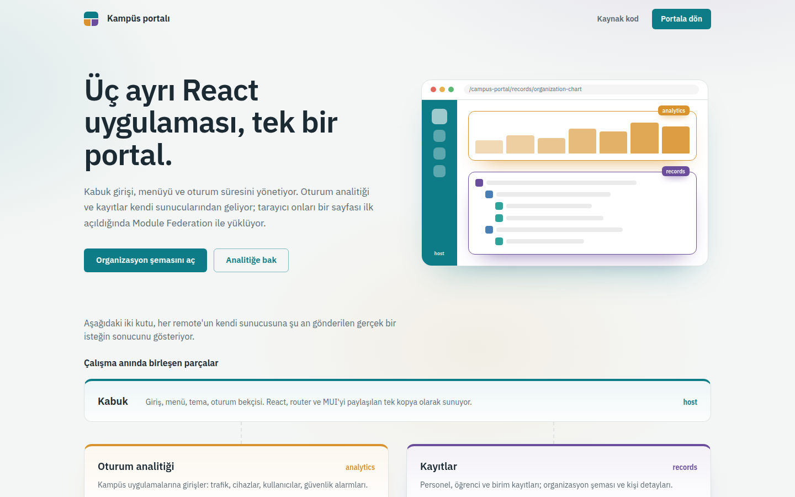
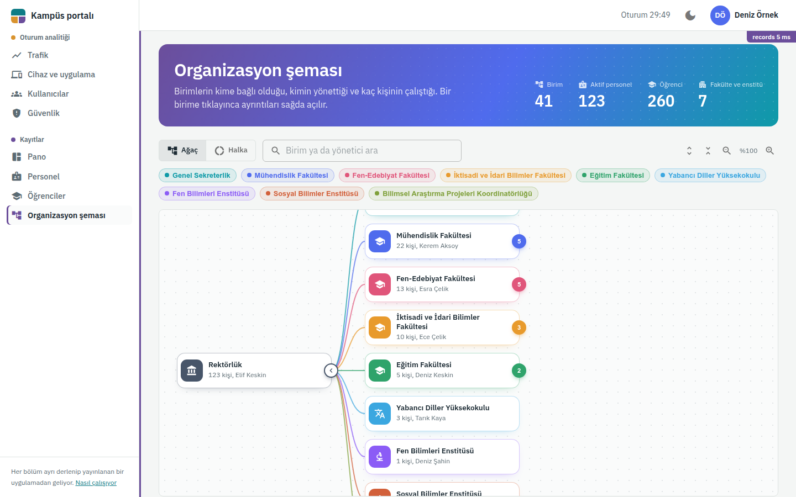
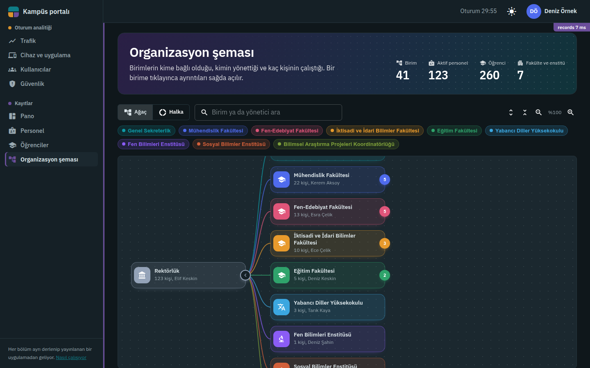

# campus-portal

A university admin portal split into three React apps that are built and deployed separately and joined in the browser with Webpack Module Federation.

**Live demo:** https://omercanbasboga.github.io/campus-portal/ (sign in with the demo account on the login page; all data is made up)



## What's in it

| App | Path | What it does |
| --- | --- | --- |
| `host` | `/` | Sign-in, navigation, theme, session timeout. Loads the other two at runtime. |
| `analytics` | `/analytics` | Login analytics for campus apps: traffic and forecasts, browsers and devices, cohorts and user segments, suspicious sessions. Highcharts. |
| `records` | `/records` | Staff, students and units: searchable lists, detail pages, and an org chart you can browse as a tree or a sunburst. |

The analytics dashboards and the records pages started as two admin panels I wrote at work. For this repo they were taken out of that codebase and rebuilt on a shared MUI kit. The paid template they used is gone, and the backends are replaced by mock adapters that serve a fictional university (41 units, 140 staff, 260 students).



## How the pieces fit

```
                 host  (shell: router, theme, session)
                /    \
   analytics/Routes   records/Routes      <- loaded on first visit
```

React, React DOM, React Router and emotion are shared as singletons. The host loads them eagerly and the remotes reuse its copies, so there is one router and one emotion cache on the page. MUI is left out on purpose. The apps import it by deep path (`@mui/material/Tabs`), and sharing those one by one would let a remote end up with half the host's components and half its own. Each app bundles the MUI parts it uses instead.

Each remote exposes one component, `./Routes`, and the host passes it `darkMode` as a prop. That prop is the whole contract. The remote builds its own MUI theme from it, and the shared `ui/` folder is compiled into every app separately, so a React context created in the host would be a different object inside a remote anyway. Passing the value explicitly also lets the remotes run on their own.

The host mounts every remote inside `RemoteFrame`, which draws a line in the remote's colour and a small tag with the time `remoteEntry.js` took to load. If a remote's server is down, its error boundary shows a message in that spot and the rest of the portal keeps working.

Remotes are built with `publicPath: "auto"`, so their chunks load relative to wherever `remoteEntry.js` came from. Their own `index.html` still gets absolute paths (patched in `shared/craco.shared.js`) so deep links work when a remote runs standalone.

The session guard signs you out with a timer when the token expires, checks again when the tab becomes visible, and follows a sign-out in another tab through the `storage` event. Keys starting with `pref:` (theme, org chart view) survive sign-out.

## Running it

```bash
npm install
npm run start:analytics   # :3002
npm run start:records     # :3003
npm run start:host        # :3001
```

With no `REACT_APP_API_BASE_URL` set, both remotes answer from their mock adapters (`*/src/api`). Each remote also runs on its own at its port.

To build what GitHub Pages serves:

```bash
./scripts/build-pages.sh          # BASE=/campus-portal by default
```

That builds the remotes into `dist/remotes/<name>/` and the host into `dist/`, and copies `index.html` to `404.html` so deep links load the app. The remotes live under `remotes/` so a reload on `/analytics` reaches the host, not the remote's standalone page.

## Layout

```
host/        shell, sign-in, session guard, landing page
analytics/   dashboard tabs + mock API
records/     pages, org chart, mock API
shared/ui/   MUI components, theme, tokens (bundled into each app)
shared/craco.shared.js   Module Federation and CRA tweaks used by all three
scripts/build-pages.sh
```



## Notes

- Stack: React 18, MUI 5, React Router 6, CRA 5 with craco 7, Highcharts 12, d3-hierarchy, antd 5 (the unit tree on the person detail page).
- Highcharts is free for personal and non-commercial use only. Using this code commercially needs a Highcharts licence.
- People, units, e-mail addresses and IP addresses are generated. Any resemblance to a real person is accidental.
